<p align="center"></p>

# Sforza: Resume, Cover Letter and Match Scoring

Score your CV against a job description, then build a tailored CV and cover letter for it.

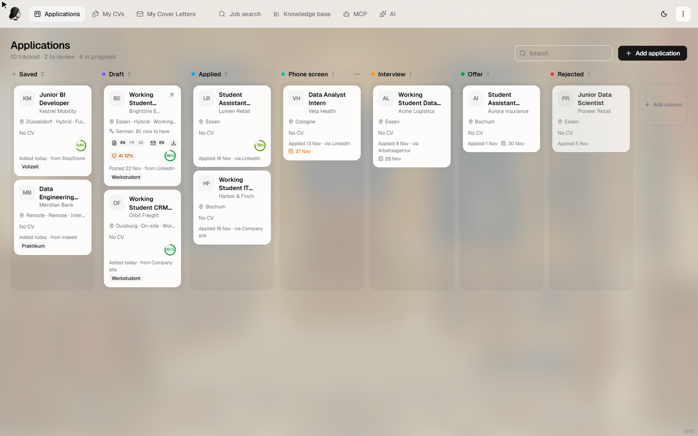

## Try the demo

Open [sforza.oussenn.com](https://sforza.oussenn.com) and sign in with:

| Username | Password |
|---|---|
| `demo` | `sforza-demo` |

Every sign-in gets its own copy of the sample data (a fictional applicant), deleted after two hours. Nobody else sees what you change. The demo has no AI, PDF export, uploads or MCP connector; your own copy of Sforza has all of them.

## Match score

Every requirement in the posting is checked against your CV, with the line that proves it.

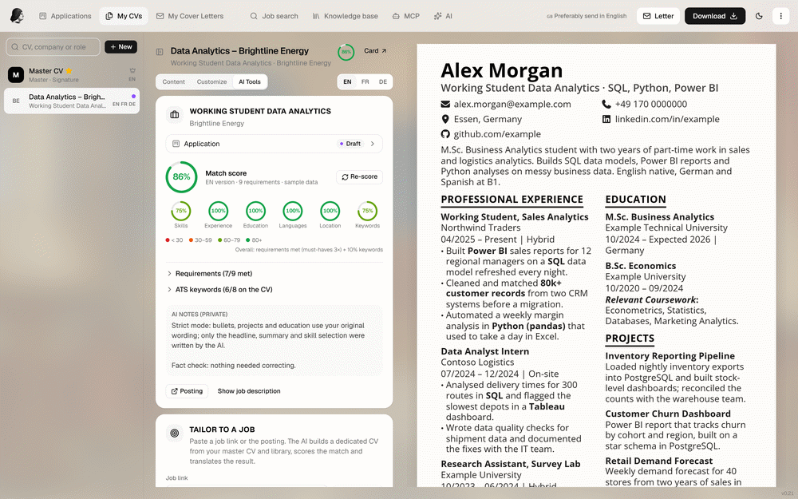

## AI-text check

Each CV and letter keeps its latest detector score, measured against your own target.

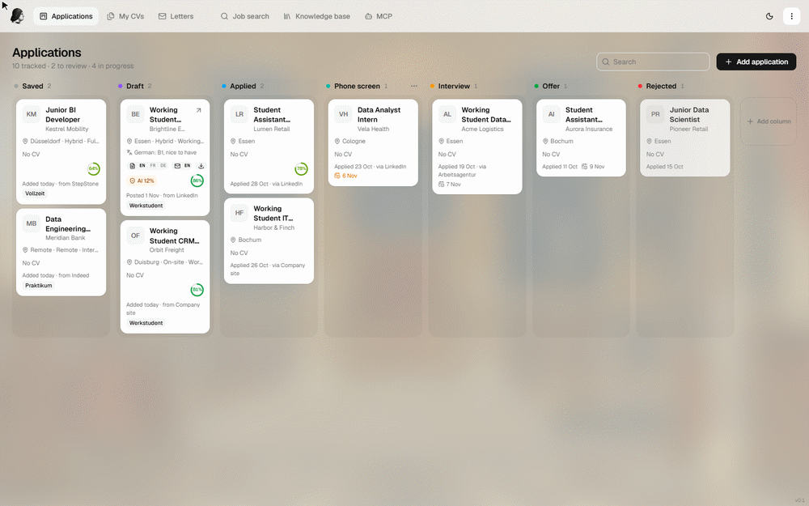

## Cover letters

Five designs. Fonts, colours and spacing follow the CV until you change them.

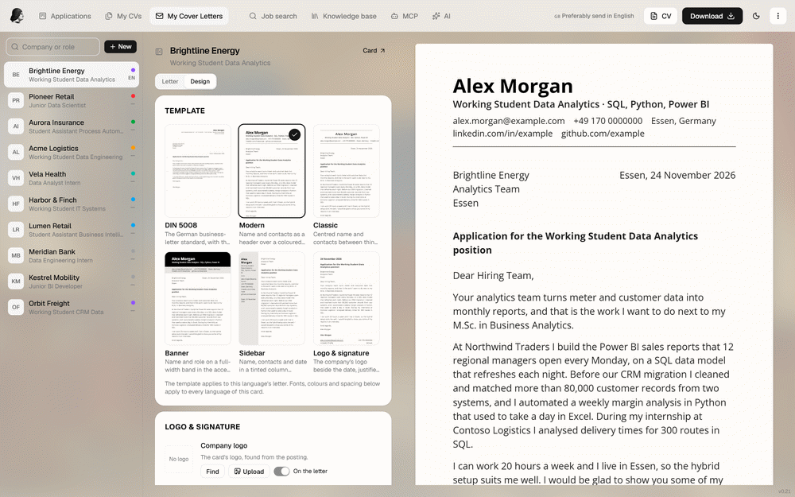

## CV templates

Nine templates on a live A4 page.

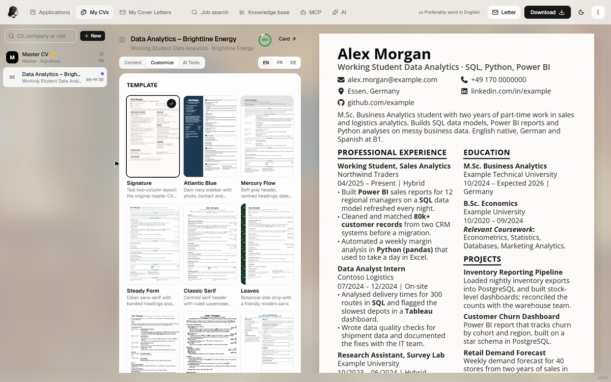

## English, French and German

Each CV can have all three.

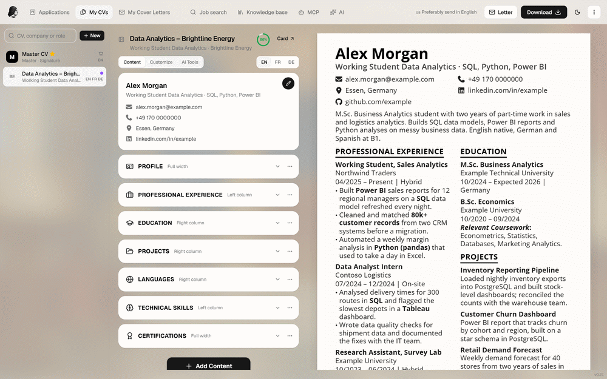

## Board

Your own columns between the stages, for your account only. Drag a card to move it.


## Knowledge base and job search

Tailored CVs and letters pick from the knowledge base. The MCP prompts are built from the job search profile.

<table>
  <tr>
    <td width="50%">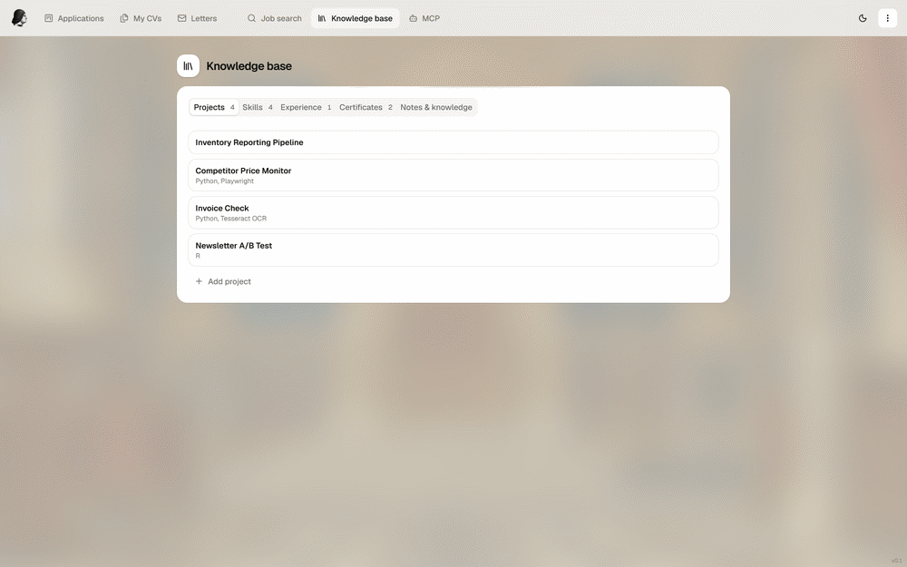</td>
    <td width="50%">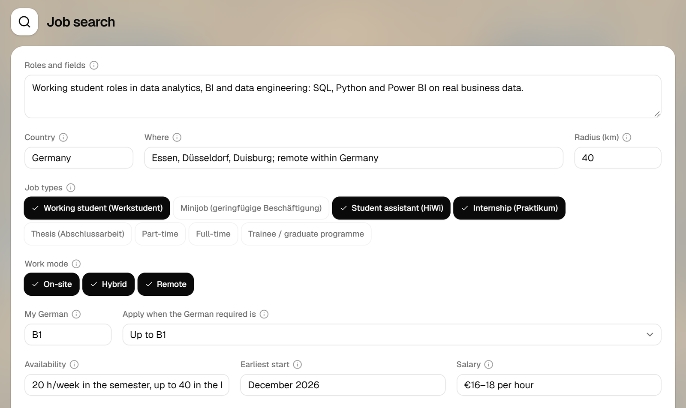</td>
  </tr>
</table>

## MCP

Connect your agent to find jobs and prepare drafts.

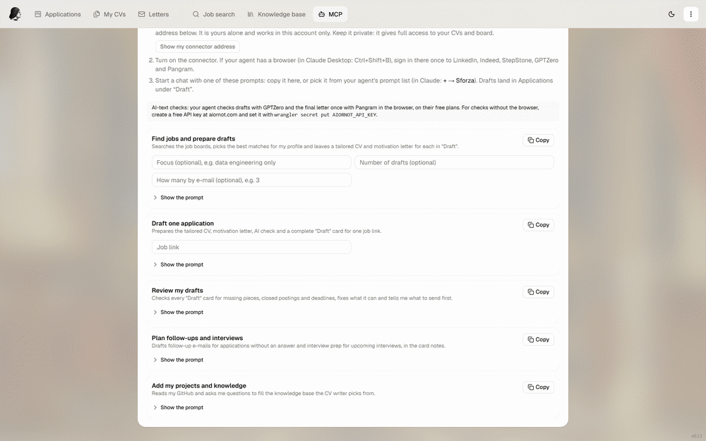

## Your own AI

Each account adds its own API key under AI in the top bar: Anthropic, OpenAI or both. The model is picked for you, or you choose one. With two keys, the other one takes over when a call fails.

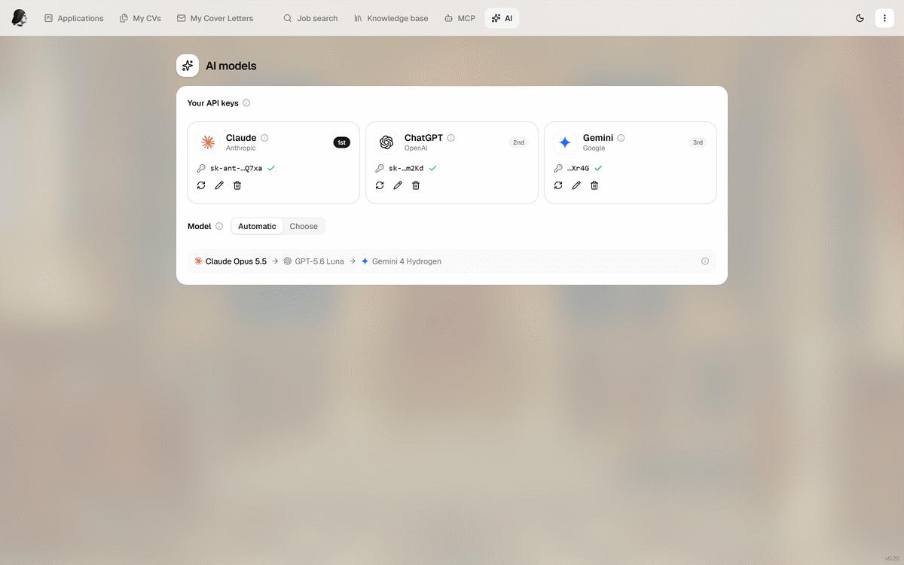

## Command palette and dark mode

<table>
  <tr>
    <td width="50%"><br><sub>Ctrl+K opens any CV, application or page</sub></td>
    <td width="50%">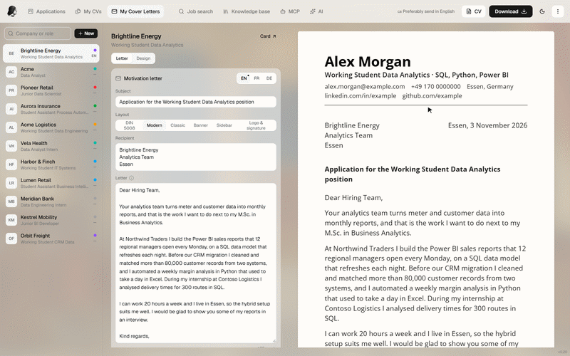<br><sub>Light and dark, on every page</sub></td>
  </tr>
</table>

## Features

- CV editor, 9 templates, A4 preview, PDF export
- English, French and German versions of each CV
- Knowledge base of projects, skills and facts
- Job reader for LinkedIn, Greenhouse, Lever, Ashby, SmartRecruiters, Workday and most career pages
- Match score with quotes from your CV as evidence
- Tailored CVs and cover letters built only from your own facts
- 6 letter templates (DIN 5008, Modern, Classic, Banner, Sidebar, Logo & signature) with their own fonts, colours and spacing, or the CV's
- Logo & signature letters: the company's logo beside the date (the card's logo, found from the posting) and your handwritten signature, uploaded once in the letter's Design panel and kept for all your letters; either can be turned off per card
- One-page fit: tailored CVs fill one page and letters fit on one, from the AI buttons and the MCP tools alike
- Your own AI for each account: an Anthropic or OpenAI API key (or both), the model picked automatically or by you, and the other key as backup when a call fails. Keys are stored encrypted and never shown again
- Board with your own columns, form answers and AI-text checks
- MCP server that can do everything the editor can
- Command palette (Ctrl+K), light and dark mode
- Works on phones and tablets: two-row top bar, one-column forms, board columns that snap, CV preview on a button
- Accounts made in the app: invitation links, password change, locking, separate data
- Optional public demo: each visitor gets a private copy of sample data that deletes itself
- Version number at the bottom right of every page: 0.19, then 0.20, 0.21 and so on, with one more digit for a small change (0.191, 0.201)

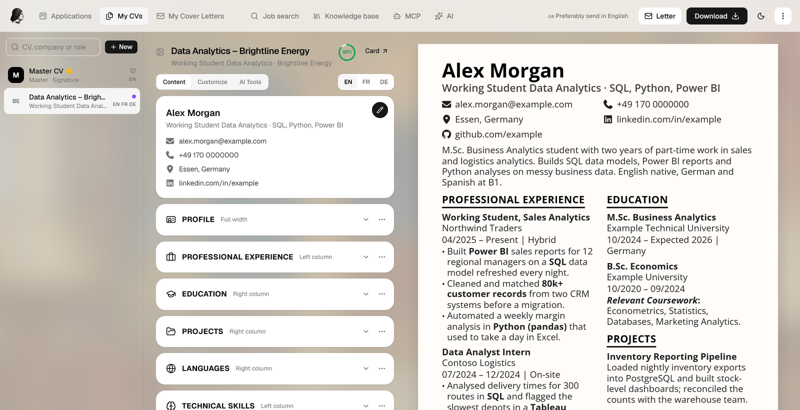

## Tech stack

| Layer | Tools |
|---|---|
| Frontend | React 19, Vite 8, TypeScript, Tailwind CSS 4, shadcn/ui (Radix UI), Zustand, Immer, cmdk, Sonner, Lucide and Font Awesome icons, Fontsource fonts |
| Backend | Cloudflare Workers, Hono, D1 (SQLite), Browser Rendering with `@cloudflare/puppeteer` for PDFs |
| AI | Anthropic SDK, OpenAI API, Workers AI (free fallback), AI or Not API (optional detector) |
| Integrations | MCP (JSON-RPC over HTTP), Bundesagentur für Arbeit job search API, LinkedIn guest job search, StepStone, Arbeitnow API, Stellenwerk, ATS public APIs |
| Tooling | Wrangler, `@cloudflare/vite-plugin`, Vitest, jsdom |

## Project layout

```
src/       React app: sign-in, editor, board, templates, pagination
worker/    API, auth, AI calls, job readers, PDF rendering, MCP server
shared/    types, helpers, prompts and template metadata used by both sides
tests/     unit tests
bench/     model benchmark for matching and tailoring (local only)
scripts/   optional account generator for the AUTH_USERS secret
design/    full-size source images of the logo and the background (public/ has the sized copies)
```

## Run locally

Requires Node 24.

```bash
npm install
cp .env.example .env
```

In `.env`, set `SESSION_SECRET` to a random string of 32 or more characters. To make one:

```bash
node -e "console.log(crypto.randomBytes(32).toString('base64url'))"
```

Then:

```bash
npm run dev
```

Open http://localhost:5173 and create your account. The local database is created on the first request.

<p align="center">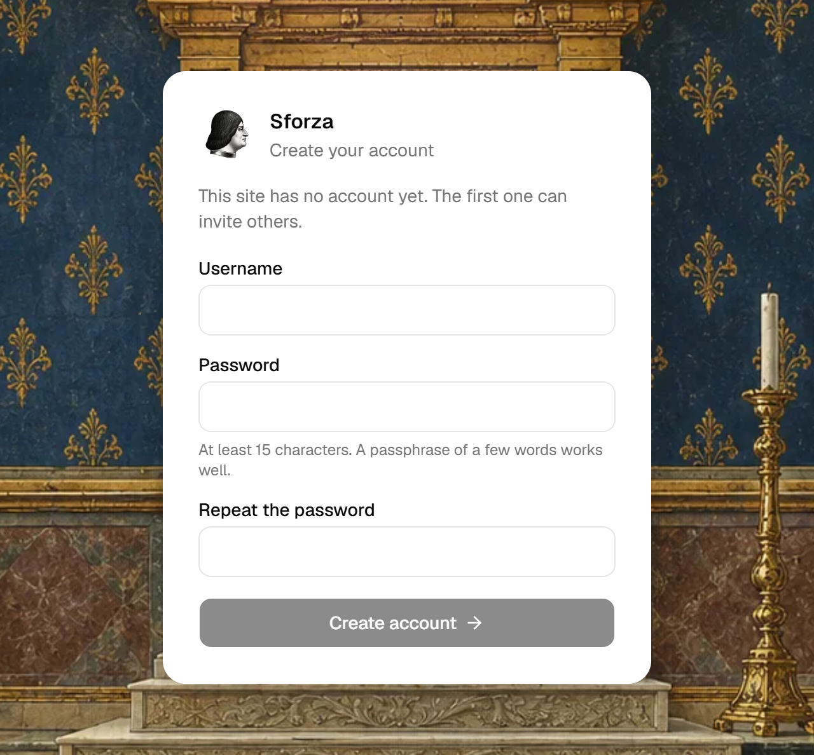</p>

The editor, board and job readers work without any API key. For the AI features, add your own Anthropic or OpenAI key under AI in the top bar. You can also give the whole site a key in `.env` for accounts without one, or run `npx wrangler login` for Workers AI. PDF download uses Cloudflare Browser Rendering and falls back to the browser print dialog.

## Environment

| Variable | Required | Purpose |
|---|---|---|
| `SESSION_SECRET` | yes | Signs sessions and download links, and encrypts the API keys saved under AI. At least 16 characters, 32 or more recommended |
| `SETUP_TOKEN` | deploy | Asked once to create the first account on a public address, so nobody else can claim a new site. Not needed locally |
| `AUTH_USERS` | no | Accounts kept in a secret instead: `{ "username": "pbkdf2-sha256$..." }`, made by `scripts/new-logins.mjs` |
| `PRIMARY_USER` | no | Account whose connector token is `MCP_TOKEN` itself. Default: first account in `AUTH_USERS` |
| `ANTHROPIC_API_KEY` | no | The site's Anthropic key, for accounts without a key of their own |
| `OPENAI_API_KEY` | no | The site's OpenAI key, used when the site has no Anthropic key |
| `MCP_TOKEN` | no | Enables the MCP server. At least 24 characters |
| `AIORNOT_API_KEY` | no | Server-side AI-text detection |
| `DEMO_PASSWORD` | no | Turns on the public demo: `demo` with this password (8+ characters) opens a private two-hour copy of the sample data. Remove it to end the demo and every demo session |
| `CANONICAL_HOST` | no | Main host name in production. Visitors on another address of the Worker move there, and links and connector addresses use it |

The site's models and its daily and monthly AI budget are set in `wrangler.jsonc` (`AI_MODEL`, `OPENAI_MODEL`, `WORKERS_AI_MODEL`, `AI_DAILY_BUDGET_USD`, `AI_MONTHLY_BUDGET_USD`). Calls on an account's own key are billed to that key and don't count against the budget.

## AI models

Under AI in the top bar (`/ai`), each account can save an Anthropic key, an OpenAI key or both. A key is checked with the provider before it's saved, so a wrong key is refused at once. It is stored encrypted for that account and never comes back to the browser or to a connected agent. The page only shows its last four characters and whether the last check passed.

- Automatic: the app picks the model for each key (the page names them). The Anthropic key runs first and the OpenAI key takes over when a call fails.
- Choose your model: a model from either list, or any model id the provider offers. The other key stays as the backup.

Only a failed call moves to the backup: a rejected key, an unknown model, a rate limit, an outage or a timeout. A declined request or a broken answer is reported as it is. Without a key of its own, an account uses the site's keys (above), then Workers AI.

Every AI button keeps the same rules an agent follows. After tailoring or translating, the CV is fitted on one full page in every language, and the notes say what was hidden or what still doesn't fit. A letter breaking the rules (220–320 words, no full-name salutation, no skill gaps, only your own facts, one page) is written again with the problem named, twice at most, and anything left is listed in the notes.

## Accounts

The first account is created on the first visit and is the admin. Under Account in the menu, the admin invites people with one-time links that expire after 7 days, and each person picks their own username and password. Everyone can change their password there, which signs out their other devices. A locked account is signed out everywhere, its connector stops, and its data stays.

<p align="center">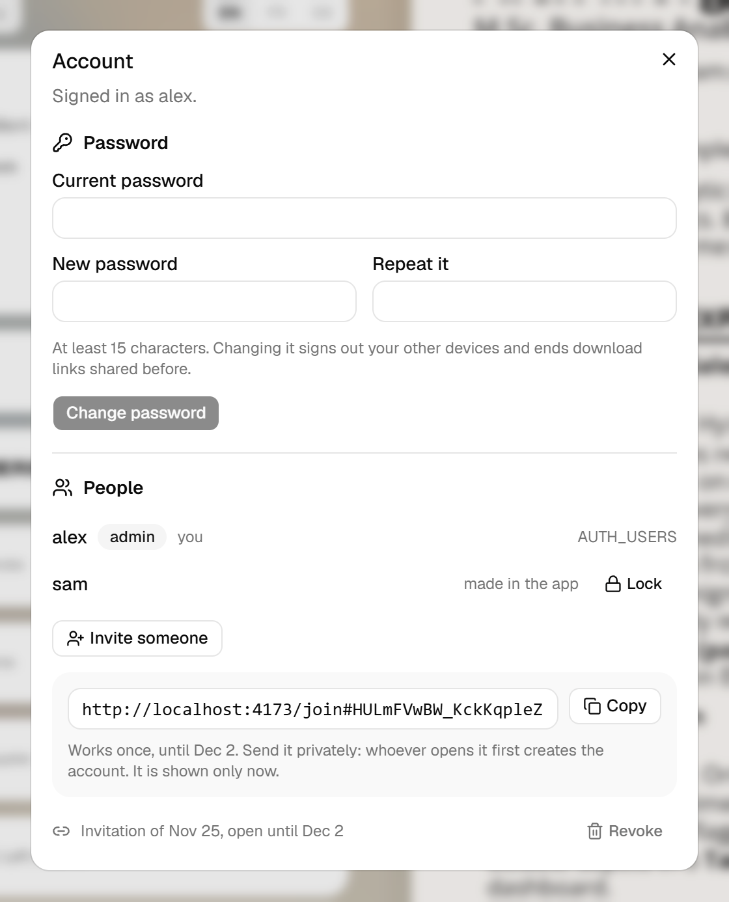</p>

Passwords need 15 or more characters and are stored only as salted PBKDF2-SHA256 hashes. Invitation codes are stored as hashes too. Accounts and passwords are not reachable through the MCP connector.

Accounts can also come from the `AUTH_USERS` secret: `node scripts/new-logins.mjs alice bob` makes the hashes. They sign in the same way, and a password changed in the app replaces the one in the secret.

## API

JSON over HTTP under `/api`. Sign in with `POST /api/auth/login` (`{ "username", "password" }`), which sets a session cookie. Every write, sign-in included, needs the header `X-Requested-With: fetch`.

| Area | Routes |
|---|---|
| Auth | `POST /api/auth/login`, `/logout`, `/setup`, `/join`, `/password`, `GET /api/auth/me` |
| Accounts (admin) | `GET /api/accounts`, `POST /api/accounts/invites`, `DELETE /api/accounts/invites/:id`, `PUT /api/accounts/:username/access` |
| CVs | `GET/POST /api/resumes`, `GET/PUT/DELETE /api/resumes/:id`, `POST /api/resumes/:id/main`, `GET /api/pdf/:id` |
| Knowledge base | `GET/PUT /api/library` |
| Job search profile | `GET/PUT /api/search-profile` |
| AI | `POST /api/ai/job-from-url`, `/match`, `/rescore`, `/tailor`, `/translate`, `/letter`, `GET /api/ai/status` |
| AI models | `GET/PUT /api/ai/settings`, `POST /api/ai/settings/check` |
| Board | `GET/POST /api/applications`, `PUT/DELETE /api/applications/:id`, `POST /api/applications/read-link`, `GET/PUT /api/board-columns` |
| Letters | `GET /api/applications/:id/letter.pdf` |
| Connector | `GET /api/connector` returns the signed-in account's MCP address |

AI routes stream progress as NDJSON. `PUT /api/ai/settings` takes `{ "keys": { "anthropic": "<key>" or null, "openai": "<key>" or null }, "mode": "auto" or "manual", "provider", "model" }` and answers without the keys.

## Connect an MCP client

Set `MCP_TOKEN`, sign in, and open MCP in the top bar (`/connector`) to copy your connector address. It looks like `https://<host>/mcp/<token>`. Each account has its own address and only sees its own data. Treat it like a password.

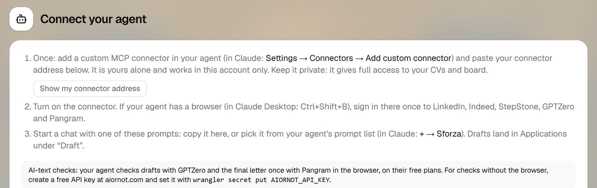

In your agent, add a custom connector named Sforza and paste the address (in Claude Desktop or claude.ai: Settings, Connectors, Add custom connector).

Other clients can call `https://<host>/mcp` with `Authorization: Bearer <token>`, for example through `mcp-remote`:

```json
{
  "mcpServers": {
    "sforza": {
      "command": "npx",
      "args": ["mcp-remote", "https://<host>/mcp", "--header", "Authorization: Bearer <token>"]
    }
  }
}
```

Locally the address is `http://localhost:5173/mcp/<token>`.

Tools:

| Group | Tools |
|---|---|
| Profile | `get_profile`, `save_search_profile`, `update_library` |
| Jobs | `search_jobs`, `triage_jobs`, `check_jobs`, `read_job_posting`, `read_application_form` |
| CVs | `get_tailoring_material`, `save_tailored_cv`, `get_cv`, `edit_cv`, `fit_cv_to_page`, `check_cv_layout`, `save_cv_translation`, `copy_cv`, `delete_cv`, `score_cv` |
| Letters | `get_letter_rules`, `save_motivation_letter`, `design_letter`, `set_signature` |
| Checks | `check_draft`, `check_ai_text`, `record_ai_check` |
| Board | `list_applications`, `get_application`, `save_application`, `save_form_answers`, `delete_application`, `get_download_links` |
| App's AI | `tailor_cv_with_site_ai`, `translate_cv_with_site_ai`, `write_motivation_letter_with_site_ai` |

Prompts: `job_hunt`, `draft_application`, `review_drafts`, `follow_up`, `build_knowledge_base`.

The job search defaults to Germany. Set a country in the job search profile to search another market.

Ask your agent for a list of jobs and it works like a daily job run. `search_jobs` searches the Bundesagentur für Arbeit, LinkedIn, StepStone, Arbeitnow and (around Dortmund and Bochum) Stellenwerk at once and merges the same job found on several boards. It screens every listing against your job search profile and remembers what earlier searches showed. The screen checks:

- posted within the last 7 days, and not an old LinkedIn ad shown with a new date
- not an Ausbildung or a thesis
- one of the job types in your profile (Werkstudent, Minijob, Praktikum…): a profile with only Werkstudent and Minijob drops every other kind
- in your places

`triage_jobs` then reads up to 10 ads in full. It checks the German each ad asks for against your limit, the ad's language, the hours and student status. It also opens each candidate's application form and lists its questions. Every listing comes back with a verdict and a reason, so the agent can report all of them, dropped ones included. Outside Germany, `search_jobs` covers LinkedIn in that country.

`edit_cv` can change everything the editor can (template, fonts, colours, spacing, placement, order, items). `fit_cv_to_page` tries font sizes, spacing and column widths on the real print page and keeps the fullest single page. If spacing alone can't fit the page, it moves a section into the column that has room. On a tailored CV it then hides the content least relevant to the posting and lists what it hid. It never hides a role, a degree, the languages or the summary, and every role keeps its best bullet.

Agents don't have to remember the page fit. Whenever `save_tailored_cv`, `edit_cv` or `save_cv_translation` leave a page that isn't full or runs over, they run the fit themselves. `check_draft` also checks the card, not just the documents: the send language, and the real application form when the posting is on a job board. It lists what a finished draft usually also has: form answers, an AI check, a fit score and the posting date.

The tools also check the writing rules as they save:

- a letter outside 220–320 words, or not written in the language it is saved under
- form answers with semicolons or colons, or that run long
- a card for a posting first published more than 7 days earlier
- documents in the wrong language: German postings get German documents (plus English when the profile asks for it), English postings English only

`check_draft` holds only the languages a card is sent in to the one-full-page rule. The English source of a CV sent in German is still measured, but doesn't block the draft.

The App's AI tools let the app write instead of the agent. They run on the account's own key when it has one (otherwise the site's AI) and keep the rules of the AI buttons: the CV fitted on one page, with its layout in the answer, and the letter written again when it breaks a rule. Agents never see the keys.

Every CV follows the same common-sense rules (adapt it to the posting, only facts from your CV and knowledge base, titles and dates as stated, one full page). Add your own under "My rules for CVs and letters" in the job search profile.

## Deploy

```bash
npx wrangler login
npx wrangler d1 create sforza-db         # put the printed id in wrangler.jsonc
npx wrangler secret put SESSION_SECRET
npx wrangler secret put SETUP_TOKEN      # any random string, asked once for the first account
npm run deploy                           # runs the tests, builds and deploys
```

Open the site and create your account with the setup token.

Add the optional secrets the same way. The app is served on `workers.dev` unless you add a route in `wrangler.jsonc`.

To move to a new domain, add it as a second route, keep the old one and set `CANONICAL_HOST` to the new host name. Visitors move to the new address, and connectors set up on the old one keep working.

## Tests

```bash
npm test
npm run typecheck
```

## Security

See [SECURITY.md](SECURITY.md) for what is in place and how to report a problem.

## License

[MIT](LICENSE)

Named after Ludovico Sforza, who in 1482 received Leonardo da Vinci's letter of application, often called the first résumé.
