<p align="center"></p>

# Sforza: Resume, Cover Letter and Match Scoring

Score your CV against a job description, then build a tailored CV and cover letter for it.

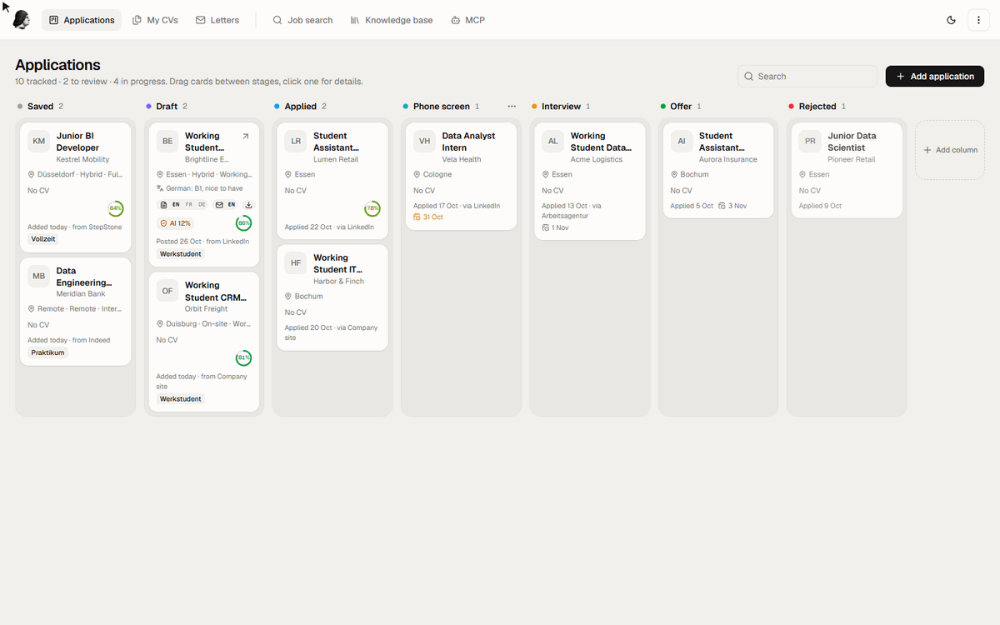

## Match score

Every requirement in the posting is checked against your CV, with the line that proves it.

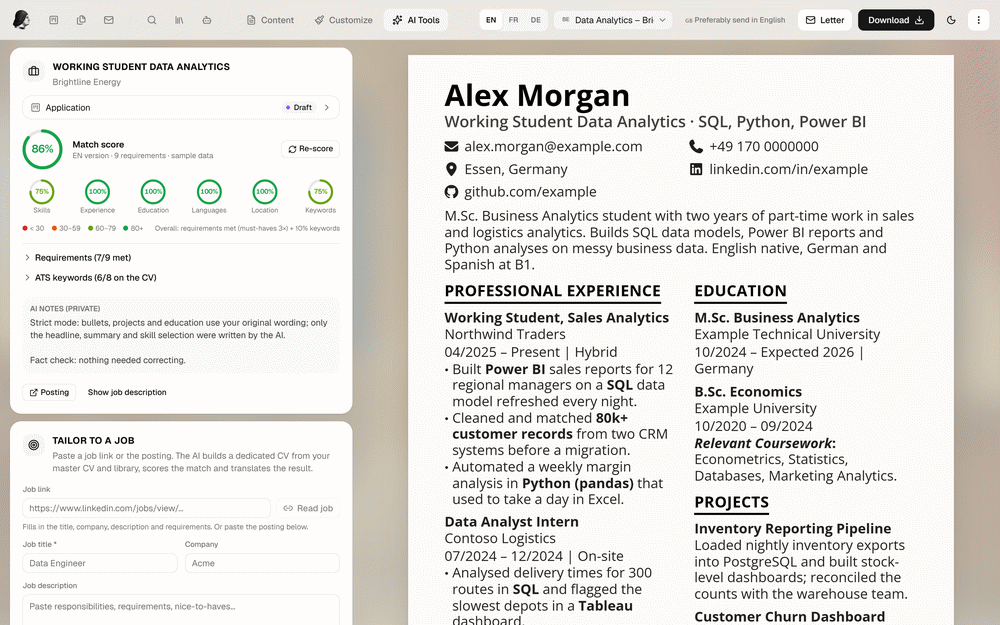

## AI-text check

Each CV and letter keeps its latest detector score, measured against your own target.

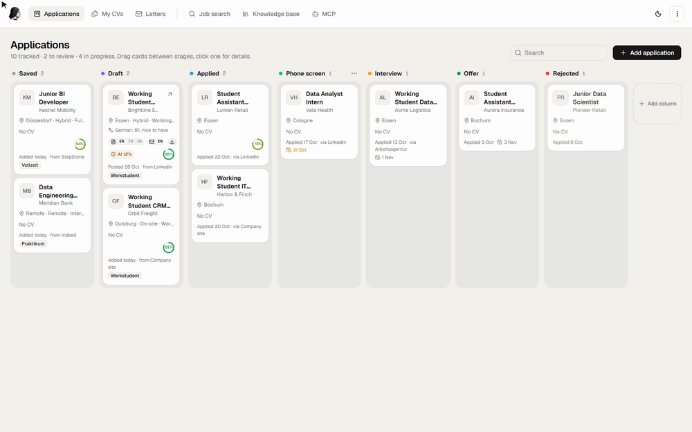

## Cover letters

Five designs. Fonts, colours and spacing follow the CV until you change them.

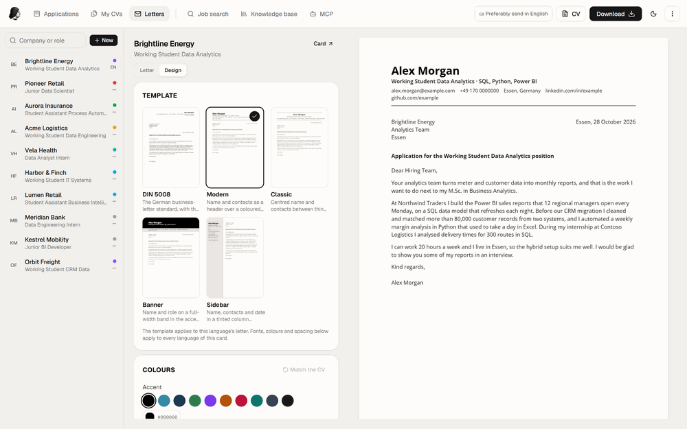

## CV templates

Eight templates on a live A4 page.

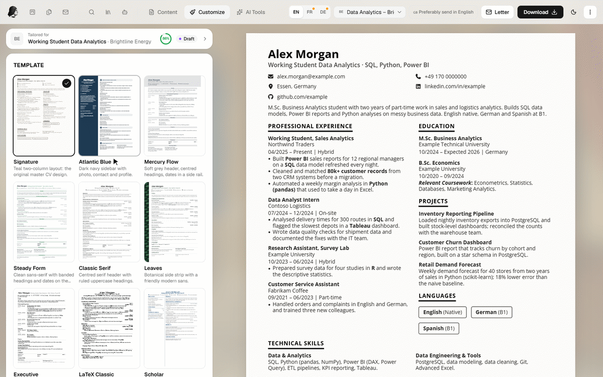

## English, French and German

Each CV can have all three.

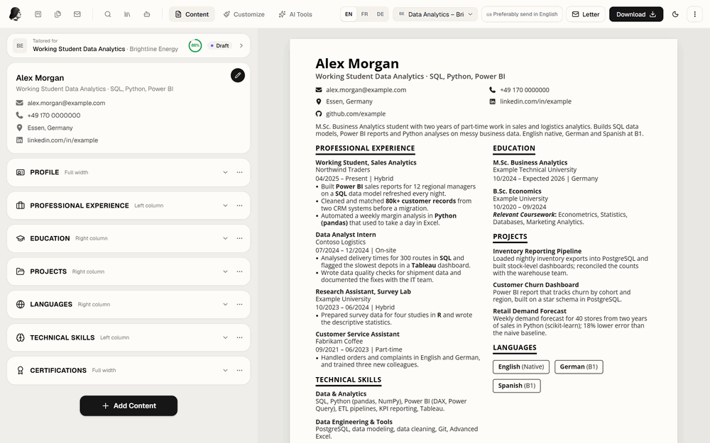

## Board

Your own columns between the stages. Drag a card to move it.

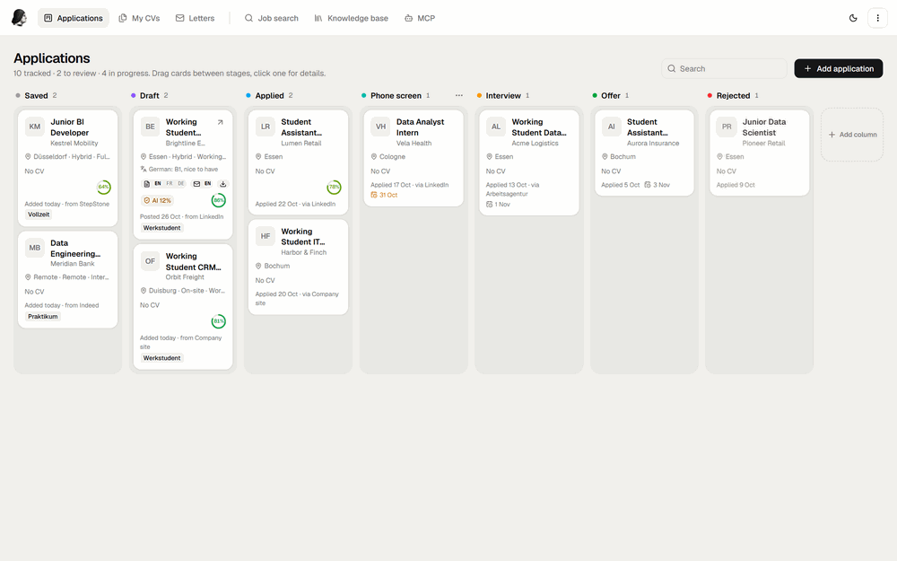

## Knowledge base and job search

Tailored CVs and letters pick from the knowledge base. The MCP prompts are built from the job search profile.

<table>
  <tr>
    <td width="50%">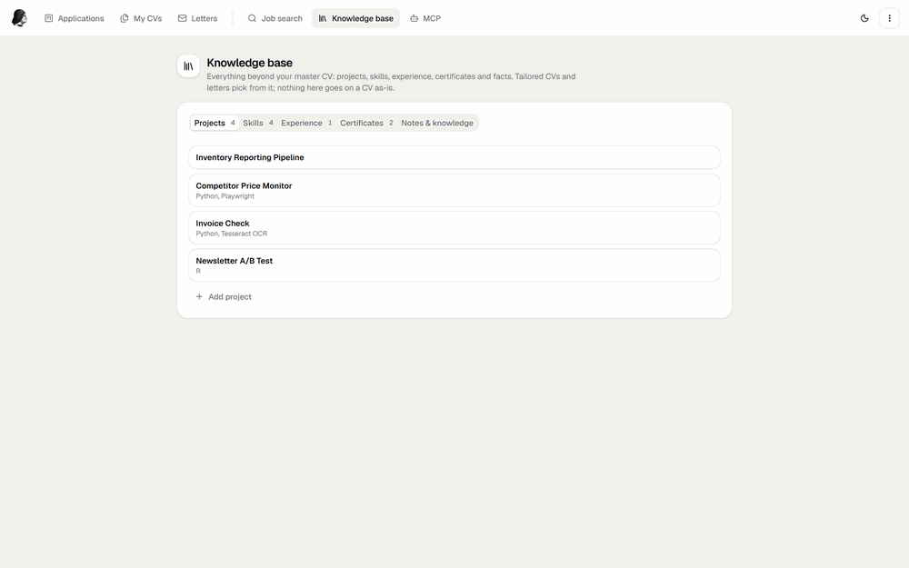</td>
    <td width="50%">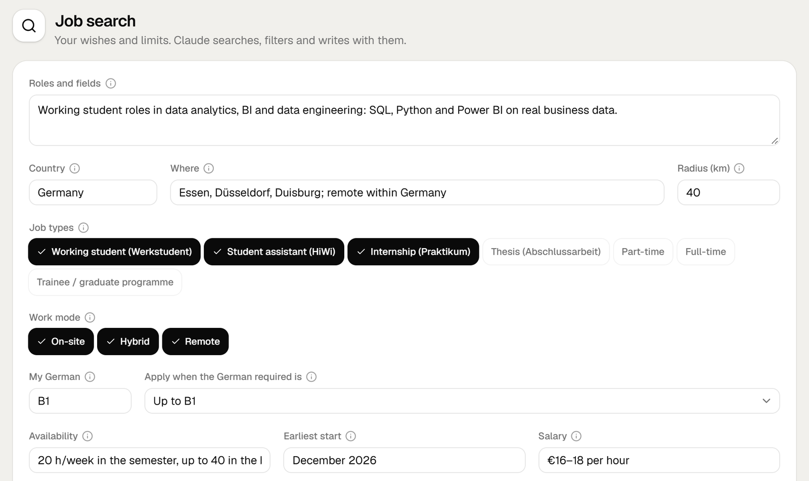</td>
  </tr>
</table>

## MCP

Connect Claude Desktop or any MCP client to find jobs and prepare drafts.

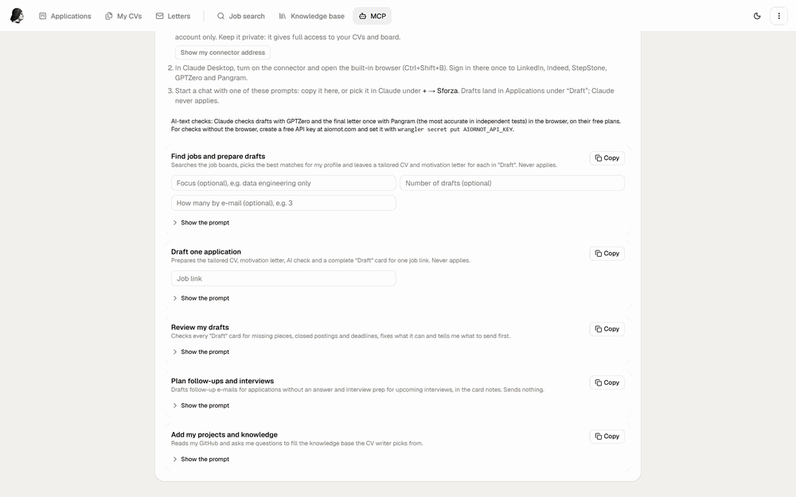

## Command palette and dark mode

<table>
  <tr>
    <td width="50%">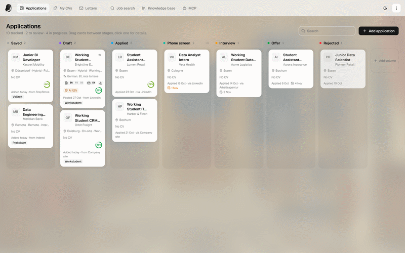<br><sub>Ctrl+K opens any CV, application or page</sub></td>
    <td width="50%">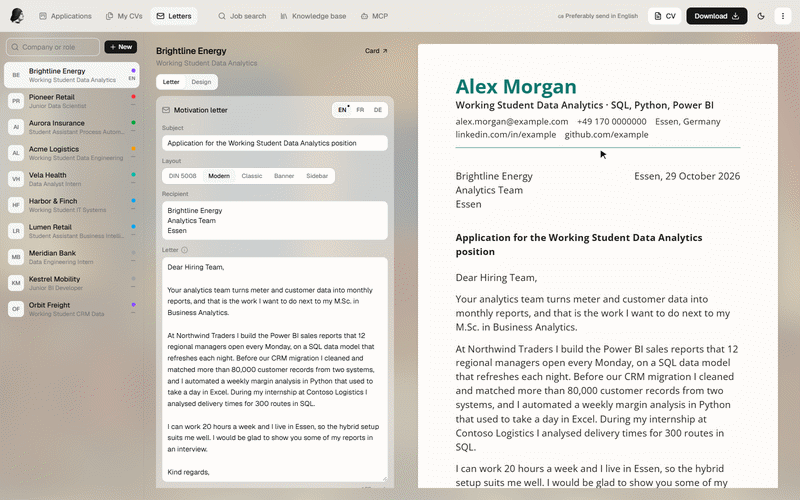<br><sub>Light and dark, on every page</sub></td>
  </tr>
</table>

## Features

- CV editor, 8 templates, A4 preview, PDF export
- English, French and German versions of each CV
- Knowledge base of projects, skills and facts
- Job reader for LinkedIn, Greenhouse, Lever, Ashby, SmartRecruiters, Workday and most career pages
- Match score with quotes from your CV as evidence
- Tailored CVs and cover letters built only from your own facts
- 5 letter templates (DIN 5008, Modern, Classic, Banner, Sidebar) with their own fonts, colours and spacing, or the CV's
- One-page check: tailored CVs fill one page, letters fit on one
- Board with your own columns, form answers and AI-text checks
- MCP server that can do everything the editor can
- Command palette (Ctrl+K), light and dark mode
- Several accounts, separate data

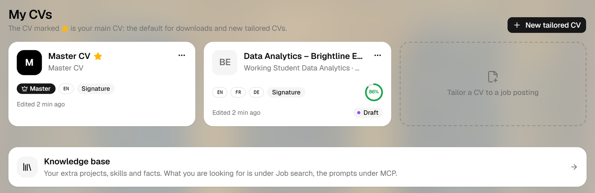

## Tech stack

| Layer | Tools |
|---|---|
| Frontend | React 19, Vite 8, TypeScript, Tailwind CSS 4, shadcn/ui (Radix UI), Zustand, Immer, cmdk, Sonner, Lucide and Font Awesome icons, Fontsource fonts |
| Backend | Cloudflare Workers, Hono, D1 (SQLite), Browser Rendering with `@cloudflare/puppeteer` for PDFs |
| AI | Anthropic SDK, OpenAI API, Workers AI (free fallback), AI or Not API (optional detector) |
| Integrations | MCP (JSON-RPC over HTTP), Bundesagentur für Arbeit job search API, ATS public APIs |
| Tooling | Wrangler, `@cloudflare/vite-plugin`, Vitest, jsdom |

## Project layout

```
src/       React app: sign-in, editor, board, templates, pagination
worker/    API, auth, AI calls, job readers, PDF rendering, MCP server
shared/    types, helpers, prompts and template metadata used by both sides
tests/     unit tests
bench/     model benchmark for matching and tailoring (local only)
scripts/   account generator
```

## Run locally

Requires Node 24.

```bash
npm install
node scripts/new-logins.mjs alice        # writes logins.txt (password) and auth-users.json (hash)
cp .env.example .env
```

In `.env`, set `SESSION_SECRET` to a random string of 32 or more characters and replace the `AUTH_USERS=` line with the one the script printed. To make a secret:

```bash
node -e "console.log(crypto.randomBytes(32).toString('base64url'))"
```

Then:

```bash
npm run dev
```

Open http://localhost:5173 and sign in with the username and password from `logins.txt`. The local database is created on the first request.

<p align="center">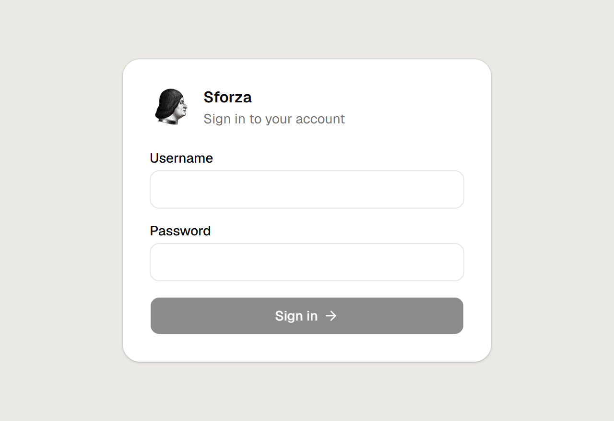</p>

The editor, board and job readers work without any API key. AI features need an Anthropic or OpenAI key in `.env`, or `npx wrangler login` for Workers AI. PDF download uses Cloudflare Browser Rendering and falls back to the browser print dialog.

## Environment

| Variable | Required | Purpose |
|---|---|---|
| `SESSION_SECRET` | yes | Signs sessions and download links. At least 16 characters, 32 or more recommended |
| `AUTH_USERS` | yes | Accounts as `{ "username": "pbkdf2-sha256$..." }`, made by `scripts/new-logins.mjs` |
| `PRIMARY_USER` | no | Account whose connector token is `MCP_TOKEN` itself. Default: first account |
| `ANTHROPIC_API_KEY` | no | Claude for tailoring, letters, matching and translation |
| `OPENAI_API_KEY` | no | OpenAI, used when no Anthropic key is set |
| `MCP_TOKEN` | no | Enables the MCP server. At least 24 characters |
| `AIORNOT_API_KEY` | no | Server-side AI-text detection |
| `CANONICAL_HOST` | no | Main host name in production. Visitors on another address of the Worker move there, and links and connector addresses use it |

Models and the daily and monthly AI budget are set in `wrangler.jsonc` (`AI_MODEL`, `OPENAI_MODEL`, `WORKERS_AI_MODEL`, `AI_DAILY_BUDGET_USD`, `AI_MONTHLY_BUDGET_USD`).

## Accounts

```bash
node scripts/new-logins.mjs alice bob
```

Each username gets a random password in `logins.txt` and a hash in `auth-users.json`. Both files are gitignored. Running the script again replaces all accounts and passwords.

## API

JSON over HTTP under `/api`. Sign in with `POST /api/auth/login` (`{ "username", "password" }`), which sets a session cookie. Every write, sign-in included, needs the header `X-Requested-With: fetch`.

| Area | Routes |
|---|---|
| Auth | `POST /api/auth/login`, `POST /api/auth/logout`, `GET /api/auth/me` |
| CVs | `GET/POST /api/resumes`, `GET/PUT/DELETE /api/resumes/:id`, `POST /api/resumes/:id/main`, `GET /api/pdf/:id` |
| Knowledge base | `GET/PUT /api/library` |
| Job search profile | `GET/PUT /api/search-profile` |
| AI | `POST /api/ai/job-from-url`, `/match`, `/rescore`, `/tailor`, `/translate`, `/letter`, `GET /api/ai/status` |
| Board | `GET/POST /api/applications`, `PUT/DELETE /api/applications/:id`, `POST /api/applications/read-link`, `GET/PUT /api/board-columns` |
| Letters | `GET /api/applications/:id/letter.pdf` |
| Connector | `GET /api/connector` returns the signed-in account's MCP address |

AI routes stream progress as NDJSON.

## Connect an MCP client

Set `MCP_TOKEN`, sign in, and open MCP in the top bar (`/edit/mcp`) to copy your connector address. It looks like `https://<host>/mcp/<token>`. Each account has its own address and only sees its own data. Treat it like a password.

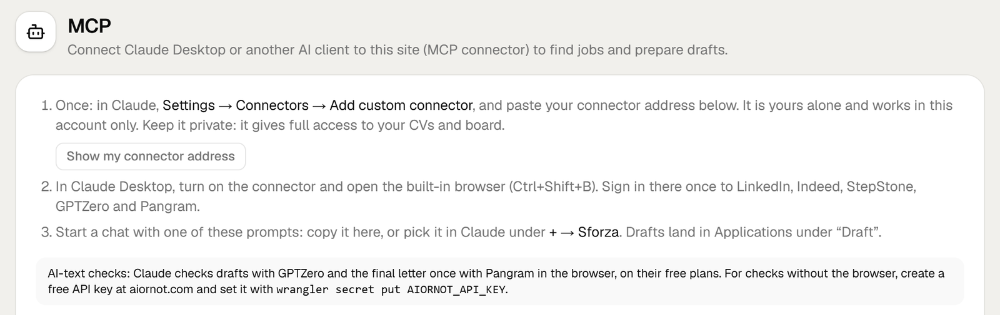

Claude Desktop or claude.ai: Settings, Connectors, Add custom connector, name it Sforza, paste the address.

Other clients can call `https://<host>/mcp` with `Authorization: Bearer <token>`, for example through `mcp-remote`:

```json
{
  "mcpServers": {
    "sforza": {
      "command": "npx",
      "args": ["mcp-remote", "https://<host>/mcp", "--header", "Authorization: Bearer <token>"]
    }
  }
}
```

Locally the address is `http://localhost:5173/mcp/<token>`.

Tools:

| Group | Tools |
|---|---|
| Profile | `get_profile`, `save_search_profile`, `update_library` |
| Jobs | `search_jobs`, `check_jobs`, `read_job_posting`, `read_application_form` |
| CVs | `get_tailoring_material`, `save_tailored_cv`, `get_cv`, `edit_cv`, `fit_cv_to_page`, `check_cv_layout`, `save_cv_translation`, `copy_cv`, `delete_cv`, `score_cv` |
| Letters | `get_letter_rules`, `save_motivation_letter`, `design_letter` |
| Checks | `check_draft`, `check_ai_text`, `record_ai_check` |
| Board | `list_applications`, `get_application`, `save_application`, `save_form_answers`, `delete_application`, `get_download_links` |
| Site AI | `tailor_cv_with_site_ai`, `translate_cv_with_site_ai`, `write_motivation_letter_with_site_ai` |

Prompts: `job_hunt`, `draft_application`, `review_drafts`, `follow_up`, `build_knowledge_base`.

The job search defaults to Germany. Set a country in the job search profile to search another market.

`edit_cv` can change everything the editor can (template, fonts, colours, spacing, placement, order, items). `fit_cv_to_page` tries font sizes, spacing and column widths on the real print page and keeps the fullest single page.

Every CV follows the same common-sense rules (adapt it to the posting, only facts from your CV and knowledge base, titles and dates as stated, one full page). Add your own under "My rules for CVs and letters" in the job search profile.

## Deploy

```bash
npx wrangler login
npx wrangler d1 create sforza-db         # put the printed id in wrangler.jsonc
npx wrangler secret put SESSION_SECRET
npx wrangler secret put AUTH_USERS < auth-users.json
npm run deploy                           # runs the tests, builds and deploys
```

Add the optional secrets the same way. The app is served on `workers.dev` unless you add a route in `wrangler.jsonc`.

To move to a new domain, add it as a second route, keep the old one and set `CANONICAL_HOST` to the new host name. Visitors move to the new address, and connectors set up on the old one keep working.

## Tests

```bash
npm test
npm run typecheck
```

## Security

See [SECURITY.md](SECURITY.md) for what is in place and how to report a problem.

## License

[MIT](LICENSE)

Named after Ludovico Sforza, who in 1482 received Leonardo da Vinci's letter of application, often called the first résumé.
